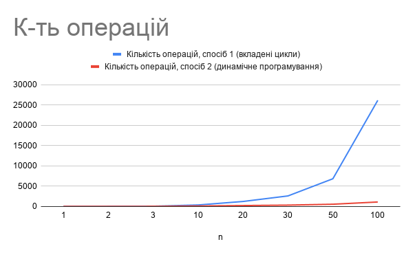
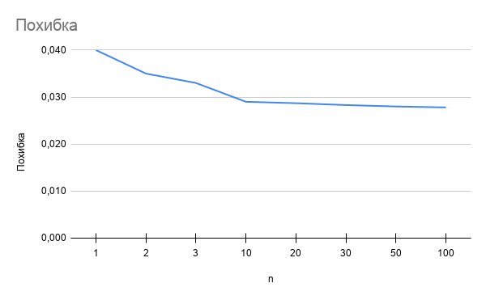

<div align = "center">
  
### Національний технічний університет України
### «Київський політехнічний інститут імені Ігоря Сікорського»
### Факультет інформатики та обчислювальної техніки
### Кафедра обчислювальної техніки
<br></br>
<br></br>
<br></br>
### Структури даних та алгоритми
### Лабораторна робота №2
"Алгоритми з вкладеними циклами та метод динамічного програмування"
</div>
<br></br>
<br></br>

<div align = "right">
Виконав: студент групи ІО-63
  
Корзун Денис Олегович

Номер в групі: 10

Перевірив:
</div>
<div align = "center">
Київ — 2026
</div>

## 1) Мета:
Засвоєння теоретичного матеріалу та набуття практичних навичок використання різних циклічних керуючих конструкцій, вкладених циклів, методу динамічного програмування та обчислення кількості операцій алгоритмів.

## 2) Завдання:
### Умова:
Задане натуральне число n. Обчислити значення заданої за варіантом формули (ряду або добутку, що наближено обчислює значення певної функції у заданій точці; точність наближення залежить від кількості ітерацій n).
Для розв'язання задачі написати дві програми:
перша програма обчислює формулу за допомогою вкладених циклів;
друга програма обчислює ту саму формулу за допомогою одного циклу з використанням методу динамічного програмування (тобто накопичуючи черговий доданок/множник на основі попереднього, без повторного обчислення статечних, факторіальних і подібних виразів «з нуля» на кожній ітерації).
Виконати розрахунок кількості операцій для кожного з алгоритмів за методикою, викладеною на лекції, додавши до неї підрахунок кількості викликів стандартних функцій.
Програма має правильно розв'язувати задачу при будь-якому заданому n, для якого результат обчислення коректно представляється типом double.
Результат виводити у форматі із сімома знаками після коми.

### Варіант 10: 


## 3) Код:
### Завдання 1:
```
#include <stdio.h>

int main() {
    double result = 1.0, x = 1/3.0, PI = 3.141592653589793, num_term = 4.0 * x * x, pi_squared = PI * PI, s_val;
    int j = 1, i = 1, n, op_count;
    printf("Введіть значення n: ");
    scanf("%d", &n);

    op_count = 11;
    
    if (n > 0) {
        while (i <= n) {
            s_val = 0.0;
            j = 1;
            
            while (j <= i) {
                s_val += (4.0 * j - 1.0);
                j++;
                op_count += 5;
            }
            
            result *= (1.0 - num_term / (pi_squared * s_val));
            i++;
            op_count += 9;
        }
        op_count += 1; 
        
        printf("Значення P:  %.7f\n", result);
        printf("Кількість виконаних операцій: %d\n", op_count);
    }
    else {
        printf("n is invalid\n");
    }

    return 0;
}
```
### Завдання 2:
```
#include <stdio.h>

int main() {
    double result = 1.0, x = 1/3.0, PI = 3.141592653589793, num_term = 4.0 * x * x, pi_squared = PI * PI, s_val = 0.0;
    int i = 1, n, op_count;

    printf("Введіть значення n: ");
    scanf("%d", &n);

    op_count = 12; 
    
    if (n > 0) {
        while (i <= n) {
            s_val += (4.0 * i - 1.0);
            result *= (1.0 - num_term / (pi_squared * s_val));
            i++;
            op_count += 11;
        }
        op_count += 1;
        
        printf("Значення P:  %.7f\n", result);
        printf("Кількість виконаних операцій: %d\n", op_count);
    }
    else {
        printf("n is invalid\n");
    }
    
    return 0;
}
```

## 4) Тестування:
### Завдання 1:

Тест 1(n=32):


Тест 2(n=154):


### Завдання 2:

Тест 1(n=32):


Тест 2(n=154):


## 5) Таблиця:

| n | 1 | 2 | 3 | 10 | 20 | 30 | 50 | 100 |
|---|---|---|---|---|---|---|---|---|
| Кількість операцій, спосіб 1 (вкладені цикли) |26|45|69|377|1242|2607|6837|26162|
| Кількість операцій, спосіб 2 (динамічне програмування) |24|35|46|123|233|343|563|1113|

## 6) Графіки:



Похибка обчислюється так, що від значення cos(1/3) віднімається P. І похибкою буде модуль цього числа.


